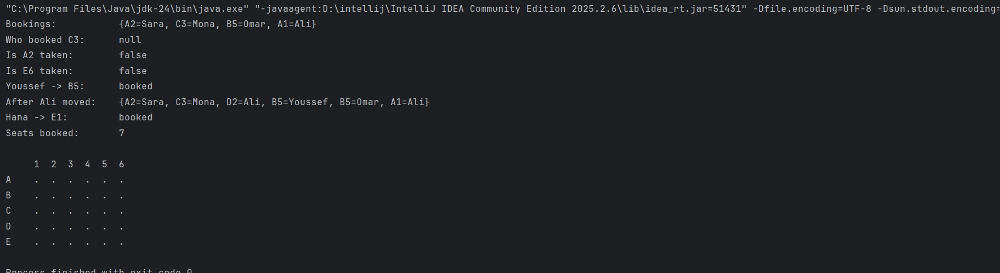
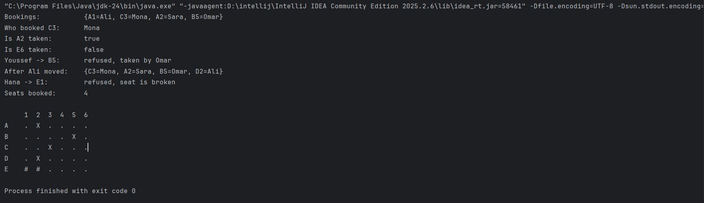
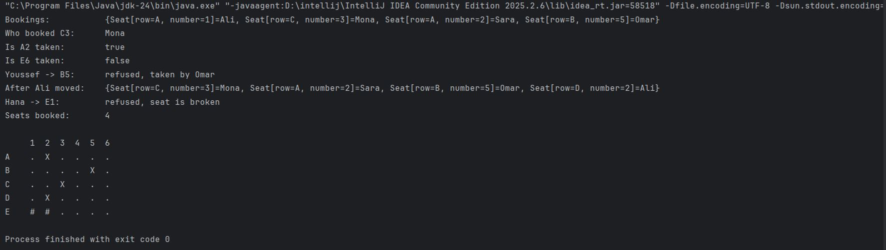

# Cinema Booking System (Task_CinemaBooking.java)

## What Happened in This Task

This project is a Java console application for a cinema seat booking system that uses a HashMap to store and manage seat reservations, while keeping the seat chart display method (printChart) working as expected.

Each seat uses final fields for row and number so its seat identity does not change after creation. The printChart method is kept untouched, and the answers to the task questions are written in comments at the end of Task_CinemaBooking.java.

## What Happened

### 1. Without equals() and hashCode()

At first, when a Seat object is placed as a key inside a HashMap and later a new Seat object with the same row and number is used to check or update the booking, Java does not know they represent the same seat unless equals() and hashCode() are overridden properly. Because of that, the HashMap lookup or matching does not behave as expected.

Screenshot for Stage 1 (Without equals() and hashCode()):

### 2. With equals() and hashCode() (Main Solution)

Next, equals() and hashCode() are implemented using the final fields (row and number). This tells Java that two Seat objects with the same row and number are equal and belong to the same hash bucket. As a result, the HashMap finds and tracks seats reliably in the main implementation while keeping printChart unchanged.

Screenshot for Stage 2 (With equals() and hashCode()):

### 3. Using record Seat(char row, int number) (Bonus)

Then, a record version (record Seat(char row, int number) {}) is shown as a bonus reference at the top of the file (kept commented out with //). In Java, a record provides a compact way to define data and automatically generates equals(), hashCode(), and toString() from its components, while the main class and printChart remain intact.

Screenshot for Stage 3 (Using record bonus):

